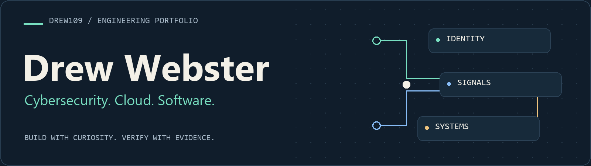
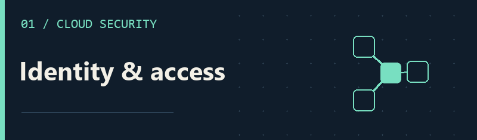
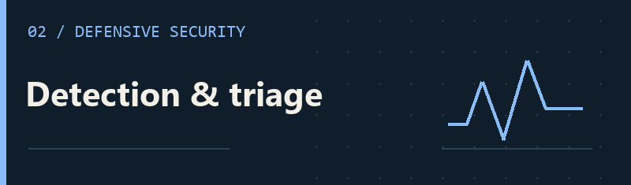
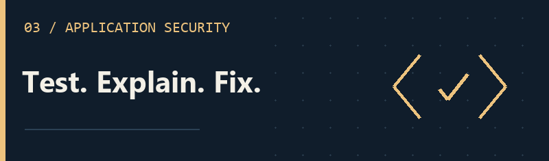

<picture>
  <source media="(max-width: 600px)" srcset="assets/header-mobile.png" />
  
</picture>

  <a href="https://drewwebster.dev/"><strong>Portfolio</strong></a> &nbsp; / &nbsp;
  <a href="https://www.linkedin.com/in/andrew-webster-cyber/"><strong>LinkedIn</strong></a> &nbsp; / &nbsp;
  <a href="#selected-work"><strong>Selected work</strong></a>

## Hey, I'm Drew.

I'm a **cybersecurity student at the University of Tampa**, graduating in **May 2027**. I like understanding how systems work, finding where they break, and building tools that make them more useful.

My background brings together **IT support, coding instruction, security labs, and AI-assisted software development**. I'm especially interested in cloud security, identity and access, and practical automation.

**CompTIA certified:** [Security+](https://cp.certmetrics.com/comptia/en/public/verify/credential/c934ed37428e44148de2cb7de5463d86) · [Network+](https://cp.certmetrics.com/comptia/en/public/verify/credential/6466397b39d14bbeab758d743a0ceb2f)

## Selected work

<table>
<tr>
<td width="50%" valign="top">

### [AWS identity & storage lab](https://github.com/drew109/aws-s3-cloudtrail-security-lab)

MFA-protected workforce access, group-based permissions, and secure S3 storage. Documented both allowed reads and denied writes, with CloudTrail audit evidence.

<code>IAM Identity Center</code> <code>S3</code> <code>CloudTrail</code>

[Authorization tests →](https://github.com/drew109/aws-s3-cloudtrail-security-lab/blob/main/TEST_RESULTS.md)

</td>
<td width="50%" valign="top">

### [Windows detection lab](https://github.com/drew109/windows-security-detection-lab)

PowerShell detections for failed logins, suspicious scripts, and local-admin changes. Synthetic Windows events become severity-ranked alerts with triage guidance.

<code>PowerShell</code> <code>Windows events</code> <code>MITRE ATT&CK</code>

[Analyst report →](https://github.com/drew109/windows-security-detection-lab/blob/main/report/alert-report.md)

</td>
</tr>
<tr>
<td width="50%" valign="top">

### [Web security assessment](https://github.com/drew109/owasp-juice-shop-security-assessment)

An authorized, local OWASP Juice Shop assessment: scoped HTTP analysis, a validated SQL-injection authentication bypass, redacted evidence, and remediation guidance.

<code>Burp Suite</code> <code>HTTP</code> <code>OWASP Top 10</code>

[Assessment report →](https://github.com/drew109/owasp-juice-shop-security-assessment/blob/main/report/assessment-report.md)

</td>
<td width="50%" valign="top">

### [Beyond the security labs](https://drewwebster.dev/)

Explore my wider portfolio of web projects, desktop tools, and automation. I use AI coding tools in my development workflow, with an emphasis on testing, troubleshooting, and documentation.

<code>Python</code> <code>JavaScript</code> <code>HTML / CSS</code> <code>Git</code>

[Explore the portfolio →](https://drewwebster.dev/)

</td>
</tr>
</table>

## What I bring

- **Support experience:** user accounts, Windows, Microsoft 365, VPN troubleshooting, and clear ticket notes.
- **Technical communication:** coding instruction and cloud-learning outreach as an AWS Student Builder Community Leader.
- **A practical approach:** define the scope, test expected and unexpected behavior, and make the results easy to follow.

I work with **Python, PowerShell, JavaScript, HTML/CSS, Git, Windows, and Linux**. The projects above show where I've applied them.

---

**Let's connect.** I'm interested in opportunities in cybersecurity, cloud/IT support, and software automation. Find me on [LinkedIn](https://www.linkedin.com/in/andrew-webster-cyber/) or visit [drewwebster.dev](https://drewwebster.dev/).
