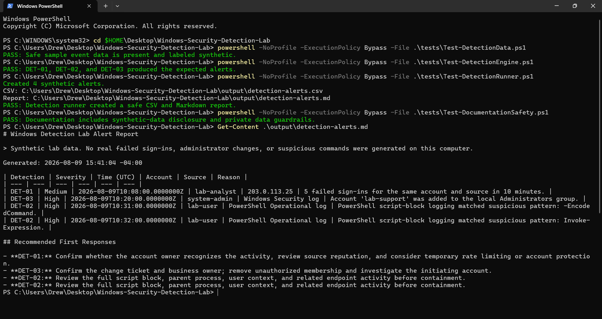

# Drew Webster

I'm a cybersecurity student at the University of Tampa, graduating in May 2027. My projects focus on AWS access controls, Windows event detection, and automation.

I also teach coding at theCoderSchool and organize cloud-learning activities as an AWS Student Builder Community Leader. Before that, I worked in IT support.

[drewwebster.dev](https://drewwebster.dev/) / [LinkedIn](https://www.linkedin.com/in/andrew-webster-cyber/)

## Selected work

### [AWS access-control lab](https://github.com/drew109/aws-s3-cloudtrail-security-lab)

An MFA-protected workforce identity with read-only access to one S3 bucket. The tests confirm that inspecting the bucket's security settings succeeds and creating an object with `s3:PutObject` is denied.

[Read the authorization tests](https://github.com/drew109/aws-s3-cloudtrail-security-lab/blob/main/TEST_RESULTS.md)

### [Windows event detections](https://github.com/drew109/windows-security-detection-lab)

A PowerShell detection engine for failed sign-ins, suspicious script blocks, and local-admin changes. The included synthetic dataset produces **four alerts**, with triage notes explaining what to investigate next.

[Read the analyst report](https://github.com/drew109/windows-security-detection-lab/blob/main/report/alert-report.md)

See the test run and sample alerts

This screenshot is from the lab's recorded test run using synthetic events.

### [Juice Shop security assessment](https://github.com/drew109/owasp-juice-shop-security-assessment)

A local OWASP Juice Shop assessment using Burp Suite. It documents an SQL-injection login bypass, the failed-login baseline, redacted evidence, and recommended fixes.

[Read the assessment](https://github.com/drew109/owasp-juice-shop-security-assessment/blob/main/report/assessment-report.md)

---

**Certifications:** [CompTIA Security+](https://cp.certmetrics.com/comptia/en/public/verify/credential/c934ed37428e44148de2cb7de5463d86) / [CompTIA Network+](https://cp.certmetrics.com/comptia/en/public/verify/credential/6466397b39d14bbeab758d743a0ceb2f)

I use AI coding tools in my project workflow. The labs above include their scope, test results, and limitations.
