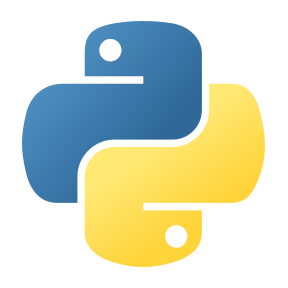
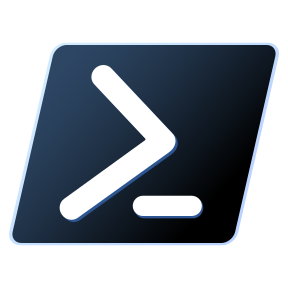
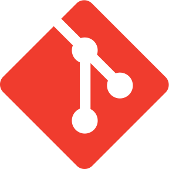
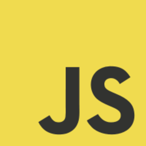

# Hey, I'm Drew 

I'm a **cybersecurity student at the University of Tampa**, graduating in **May 2027**. I work on AWS security labs, Windows detections, and tools that automate everyday tasks.

I teach coding at **theCoderSchool** and organize cloud-learning activities as an **AWS Student Builder Community Leader**. My background also includes IT support.

**[Portfolio](https://drewwebster.dev/)** &nbsp; / &nbsp; **[LinkedIn](https://www.linkedin.com/in/andrew-webster-cyber/)**

### Tools I use

  <a href="https://github.com/drew109/aws-s3-cloudtrail-security-lab" title="AWS"><picture><source media="(prefers-color-scheme: dark)" srcset="assets/icons/aws-dark.png" /></picture></a> &nbsp;
   &nbsp;
   &nbsp;
   &nbsp;
   &nbsp;
   &nbsp;
  

## Selected work

###  [AWS access-control lab](https://github.com/drew109/aws-s3-cloudtrail-security-lab)

An MFA-protected workforce identity with read-only access to one S3 bucket. The tests confirm that inspecting the bucket's security settings succeeds and creating an object with `s3:PutObject` is denied.

[Read the authorization tests](https://github.com/drew109/aws-s3-cloudtrail-security-lab/blob/main/TEST_RESULTS.md)

###  [Windows event detections](https://github.com/drew109/windows-security-detection-lab)

A PowerShell detection engine for failed sign-ins, suspicious script blocks, and local-admin changes. The included synthetic dataset produces **four alerts**, with triage notes explaining what to investigate next.

[Read the analyst report](https://github.com/drew109/windows-security-detection-lab/blob/main/report/alert-report.md)

See the test run and sample alerts

This screenshot is from the lab's recorded test run using synthetic events.

###  [Juice Shop security assessment](https://github.com/drew109/owasp-juice-shop-security-assessment)

A local OWASP Juice Shop assessment using Burp Suite. It documents an SQL-injection login bypass, the failed-login baseline, redacted evidence, and recommended fixes.

[Read the assessment](https://github.com/drew109/owasp-juice-shop-security-assessment/blob/main/report/assessment-report.md)

---

**Certifications:** [CompTIA Security+](https://cp.certmetrics.com/comptia/en/public/verify/credential/c934ed37428e44148de2cb7de5463d86) / [CompTIA Network+](https://cp.certmetrics.com/comptia/en/public/verify/credential/6466397b39d14bbeab758d743a0ceb2f)

I use AI coding tools in my project workflow. The labs above include their scope, test results, and limitations.

[Artwork & icon credits](assets/CREDITS.md)
